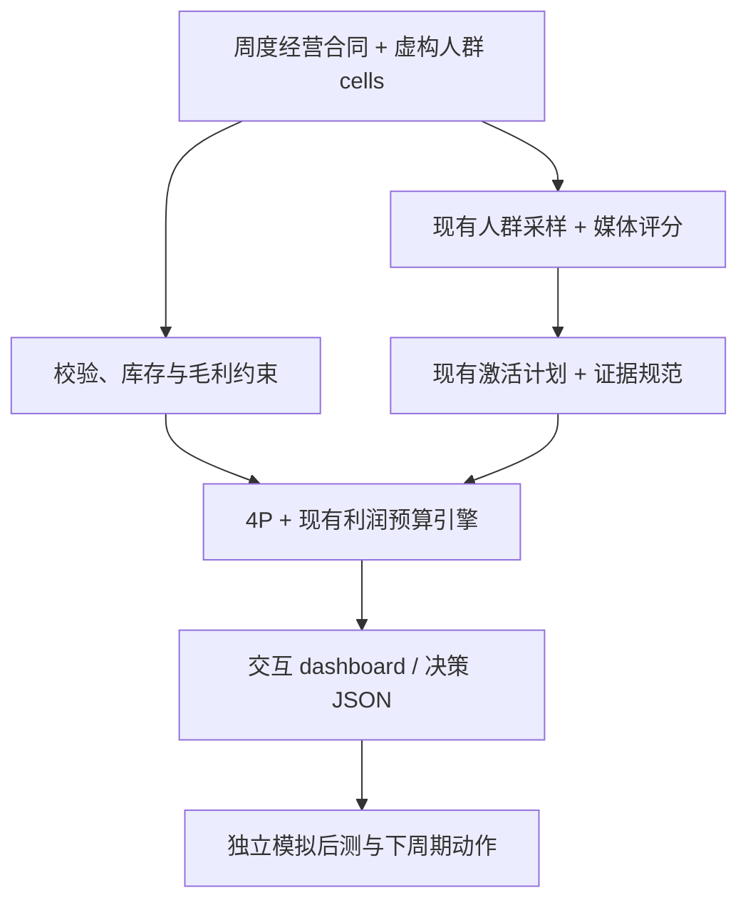

# 架构与复用边界

`server.py` 只在 localhost 运行，提供 HTML 和 `/api/plan`。每次筛选、改场景或改预算都重新调用完整 `engine.plan()`；不在浏览器用另一套预算公式。`adapters.py` 加载原有科研模块，把输入及证据映射成明确接口。`contract.py` 检查经营不变量和两个上游 evidence schemas。`dashboard.html` 无 CDN 和第三方浏览器依赖。

## 三仓库的组织

- 本 PR 在 scientific-marketing 仓库新增 `prototypes/2c_gtm`，直接引用仓库原有投资和激活模块，未改写原有模块。
- 外部两仓库的必要代码/schema 以固定 commit 的原样副本放在 `vendor/`，运行时不拉最新版本，确保离线复现。
- `vendor-manifest.json` 记录仓库、commit、文件路径和 SHA256。文件没有改动；兼容修正均在 adapters 层。
- 升级上游版本时先更新 manifest、运行原文件 hash 检查和端到端测试，再审查假设/响应口径。

## 证据和预算

1. 规则亲和度来自虚构特征，无真实购买数据，输出 preference_heterogeneity / uncalibrated。
2. 模拟随机样例使用处理/对照转化差与独立二项分布正态近似 95% 区间。只匹配同一完整单元、场景和媒体动作；优化使用区间下界。
3. signal schema 可以表达实验结构，但 simulation 限制和 fictional metadata 始终保留；投资层使用 modeled_hte，绝不 randomized_hte，因此不会出现 validated badge。
4. 没有匹配实验时，tau = 0.01 × 亲和度。这是显式假设，每单元最高 €300；模拟实验单元最高 €1,500。不能迁移成真实预算承诺。
5. 库存容量通过限制 response curve 的 reachable_population 进入已有引擎：R = min(虚构可达人群, 增量库存容量/tau)。因此 R×tau 是库存上限。
6. 饱和曲线参数 k=0.002 为情景假设，原有引擎按 €50 的边际收益步长排序，边际贡献/投入至少 1.1。未达到门槛或阻塞时保留预算。
7. 优惠建议单独算折扣后毛利，不进入媒体分配；同一经营单元只选一个媒体动作，避免本单元响应重复加总。

## 企业版本的下一步

用真实 PISI/Workplace 只读导出替换输入连接，增加 VAT/FX、退货 cohort、仓库/门店库存、确定 ETA 与 owner。之后接入真实随机对照数据、对人群和响应进行校准，处理跨渠道重叠、品牌长期效果与价格蚕食。生成营销素材属于可选上层能力，不参与效应宣判。任何投放、补货、调拨或价格修改都需要另建执行与审批接口。

## 验证范围

Python 测试覆盖合同、预算、库存、证据降级、采样权重、真实样本接线及 HTTP。Node 测试运行实际页面 JavaScript，通过 DOM 仿真连接真实 Python HTTP 服务，验证筛选与重算。它没有浏览器布局引擎；此交付不声称完成桌面/移动端视觉验收。
